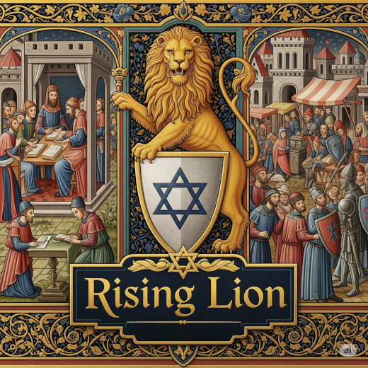

<p align="center"></p>

# Rising Lion: Canaanite Flavor Pack

A Crusader Kings III mod about the Levant, Mesopotamia and the Jewish world: Jewish families and Exilarchs, the
old gods of Canaan, Aram and Assyria, the Sabians of Harran and the Mandaeans of the marshes.

- **Version:** 0.15.1 (0.16 in progress)
- **Game version:** CK3 1.21.* "Florin"
- **Steam Workshop:** [Rising Lion - Canaanite Flavor Pack](https://steamcommunity.com/sharedfiles/filedetails/?id=3501948259)
- **Tags:** Religion, Culture, Decisions, Flavor

---

## What the mod adds

### Jewish families and the Familial government

- **Familial**, a landless government for the families of protected minorities, modelled on the historical
  Nasi. A family holds a family title and an estate in a city, and lives as the tributary of the county's lord
  under **Patronage**: taxes, religious rights and its own courts (the Beit Din).
- Jewish family heads are **Mar** and **Geveret**; their arms are a banner hemmed like a Torah mantle, topped with
  a kippah, or the Keter Shem Tov for an Exilarch.
- Estate buildings of their own: the **Yeshiva**, **Beit Din**, **Beit Knesset**, Counting House and Hachnasat
  Orchim, and with Silk & Silver the merchant companies' towers, accounting office and trade route buildings.
- Eight court positions: Rosh Yeshiva, Av Beit Din, Paytan, Chazan, Gabbai Tzedakah, Shaliach, Sofer and Parnas,
  with tasks of their own.
- Twelve non-martial **contracts** (Roads to Power): loans, tolls, caravans on the Radhanite roads, embassies,
  redeeming captives, physicians, translations, responsa, news from correspondents, debtors and more.
- Families **migrate** to more welcoming realms, can turn into a merchant company (Silk & Silver) or settle as a
  family from a company or an adventurer's camp, and up to 40 new Jewish families settle across Europe, the
  Middle East and North Africa at game start (Roads to Power).
- A **Familial** button in the lobby's ruler designer, to start as a family of your own.

### Jews in gentile realms

- **Expel the Jews** and **Readmit the Jews** for Christian and Muslim rulers, with a shared war of resistance
  for the expelled lords.
- **Shtadlanut**: a family head intercedes with a ruler for readmission, a letter of protection, a prisoner's
  release or easier terms.
- The **Court Financier**, a Jewish financier at a gentile court.

### The Exilarchate

- Two rival Exilarchs, the Rabbinic (Beit Bustenai, of the line of David) and the Karaite (Beit Anan), each a
  figurehead title elected by its own faith, with history back to the Babylonian exile.
- The **Claim Exilarchate** decision and scheme. The Exilarchate is held by Familial heads only.
- The **Davidic Line** trait (male line) and its dynasty legacy, from Traditional Slingers to Solomon's Wisdom.

### Faiths

- **Rabbinism** and **Karaism**, and **Kohanism**, the priestly faith of a rebuilt Temple, with its Kohen Gadol.
- **The Third Temple**: clear the Temple Mount and rebuild the Temple in Yerushalayim through two great projects.
- **Canaanism**, the faith of the Phoenician cities (Baalism, Tanitism of Carthage, and Yahwism, the old faith of
  Yisrael and Yehuda), **Mesopotamianism** (Ashurism and Sinism, the faith of Sin of Harran) and
  **Arameanism** (Hadadism, Belism of Palmyra and Atargatism of Manbij), the Levantine religion. All three are
  closed until restored by a temple, a decision or a new empire.
- **Temples of the old gods** as great projects: Sin at Harran, Ashur, Ishtar at Arbela, Shamash at Hatra, the
  Esagila at Babylon (on our own ziggurat models), Melqart, Eshmun, Baal, Tanit, Astarte and the Lady of Byblos,
  and the five temples of Aram. Dig the mound of Nineveh for Ashurbanipal's tablets.
- New rites are named after a god by the founder's city or tenets (Mardukism, Melqartism, Rimmonism and 29 more),
  each with the god's own icon.
- **Mandaeans and Sabians**: the Rish Amma as head of faith, the Masbuta, the Ginza Rabba, the Haran Gawaita;
  Sabian and Mandaean families with positions and buildings of their own; the Sabian Court Astrologer, the
  Question of the Sabians and the Sabian scholars at Muslim courts.

### The Return of the Moon God

A five-act story for the Sabian house of Thabit ibn Qurra, playable in Baghdad at 867: win the Sabians' standing
at the Caliph's court, return to Harran, throw off the Caliph, rebuild the Temple of Sin and unveil the old gods,
and bring the statues of the gods home.

### Festivals

Feasts of each faith in their season: **Pesach**, **Purim**, **Sukkot** and **Hanukkah** for the Jewish faiths,
Akitu, the Pyre and the Feast of Nisan for the old gods, Parwanaya and Dehwa Rabba for the Mandaeans.

### Cultures

- Hebrew, Edomite, Canaanite, Phoenician, Radhanite, Bavlim and Aramean, with vanilla's Musta'arabi, Mandaean and
  Remenkhemi where 1.21 added them.
- Hebrew, Aramaic, Assyrian and Phoenician place names; every Jewish culture has its own name list, drawn from
  the names its community used.
- Cultural men-at-arms: Palmyrene Archers, Clibanarii, Bowmen of Seir, the Sacred Band, Nile Archers.
- Jewish cultures share the innovations of the peoples they lived among.

### Decisions and titles

- Form the Hebrew, Edomite and Canaanite cultures.
- The Kingdoms of Yehuda, Edom, Upper and Lower Egypt; Phoenicia; the Empires of **Canaan**, **Kemet**,
  **Beth Nahrain** and **Aram Rabba**; and the **Hegemony of the Fertile Crescent** over them all.
- Reestablish a Phoenician trade city at Tyre, Sidon, Beirut, Tripoli and other old ports.
- **Masada**, a three-tier fortress in the Negev.

### 867 starts (The Jewish World bookmark)

- **Hasdai II ben Natronai**, the Rabbinic Exilarch
- **Boaz I ben Yehoshafat**, the Karaite Exilarch
- **Pinchas ben Abdimi**, a Davidic claimant in Eretz Yisrael
- **Binyamin**, a Radhanite chieftain at Tmutarakan
- **Manasseh II**, the Khazar Khagan
- **Dawit ben Gideon** of the Beta Israel (hard)

Thabit ibn Qurra is playable from the map. Other playable houses: Kalonymos, Shealtiel, Benveniste, the
Makhirites, Maimon (with Maimonides) and Beit Nathan.

---

## Requirements

- Crusader Kings III **1.21.\***
- No DLC is required. Some content needs one:
  - **Roads to Power**: family contracts, the families created at game start, Become a Familial House
  - **Silk & Silver**: Found a Merchant Company and the merchant estate buildings
  - Vanilla positions' tasks from a DLC need that DLC

## Installation

**Steam Workshop:** subscribe to
[Rising Lion - Canaanite Flavor Pack](https://steamcommunity.com/sharedfiles/filedetails/?id=3501948259) and enable
it in a playset.

**Manually, from this repository:**

1. Clone or download it into `Documents/Paradox Interactive/Crusader Kings III/mod/`, e.g. as `jewitup`.
2. Next to that folder, create `jewitup.mod` with the contents of `descriptor.mod` plus a path line:
   ```
   path="C:/Users/<you>/Documents/Paradox Interactive/Crusader Kings III/mod/jewitup"
   ```
3. Enable **Rising Lion - Canaanite Flavor Pack** in the launcher's playset.

**Saves:** saves from an earlier version of the mod are not compatible. Start a new game after updating.

---

## Compatibility

**Compatible**

- **Cultures Expanded** (0.10.1 and later).
- **Aligned Realm Banners**: load Rising Lion *after* it. Both replace the realm banner GUI, and ours is built on
  its copy, so both mods' decorations show.
- **More Provinces Expanded**: use the **Rising Lion MPE Compatch** and load it after both MPE and Rising Lion.

**Incompatible**

- **Combined Titles & Coats of Arms**: causes duplicate `title_event` errors and a very slow start, and its
  `gui/window_county_view.gui` hides the families' Move Estate button.
- Other mods that replace any of these files, which Rising Lion replaces whole:
  - `gui/hud.gui` (hides the council tab for Familial heads)
  - `gui/multiplayer_types.gui` (the lobby's Familial button)
  - `gui/window_county_view.gui` (the Move Estate button)
  - `gui/shared/coat_of_arms.gui` (realm banners; Aligned Realm Banners excepted)
  - `gui/window_situation_list.gui` (the Sabian story window)
  - `common/on_action/yearly_on_actions.txt`
  - `common/activities/activity_types/feast.txt`
  - `common/struggle/struggles/persian_struggle_script.txt`
  - `common/coat_of_arms/template_lists/colored_emblem_lists.txt`
- Map mods other than MPE: decisions look up their lands by region
  (`map_data/geographical_regions/jip_geographical_regions.txt`), so a map mod needs a compatch for the regions and
  the landed titles.

---

## Roadmap

### 0.16: The Exilarchs and the Maccabees (in progress)

Built so far:

- Familial gameplay: Patronage in place of the Charter of Privileges, a family that defends rather than conquers,
  no council tab, merchant buildings and contracts, trade route profits, adventurers settling as families, and
  the lobby's Familial button
- Purim, Sukkot and Hanukkah
- The Exilarchate held by Familial heads only

Planned (full plan in [.docs/v0.16_exilarchs_and_maccabees.md](.docs/v0.16_exilarchs_and_maccabees.md)):

1. The feud of Beit Bustenai and Beit Anan, and the **Geonim** of Sura and Pumbedita as court positions
2. **Rav Se'adyah Gaon**
3. Stories for the **Rabbinic Exilarch** and the **Karaite Nasi**, and the great yeshivot
4. A **Hasmonean heir**, and the return of the Maccabees
5. Beit Nathan's story: the lost crown
6. The **Palestinian Gaonate** in Yerushalayim
7. **Eldad ha-Dani** and **Queen Helena of Adiabene**
8. Reconciliation: one Israel again

### 0.17

- The **Nagid** of Egypt

Earlier versions' plans are in [.docs/](.docs/), and every release's changes in [CHANGELOG](CHANGELOG).

---

## For contributors

- [CLAUDE.md](CLAUDE.md) describes how the mod is built, file by file.
- Every copy of a vanilla file is generated by a script in [tools/](tools/) (`make_*.py`), never edited by hand.
  After a game update, rerun the generators; each one fails loudly when vanilla's text has moved.
- Every event that opens a window carries the mod's banner (`jip_event_source_badge`).
- Bugs and plans are tracked in [GitHub issues](https://github.com/StavSaad/ck3_mods-jewish_flavor_pack/issues).
